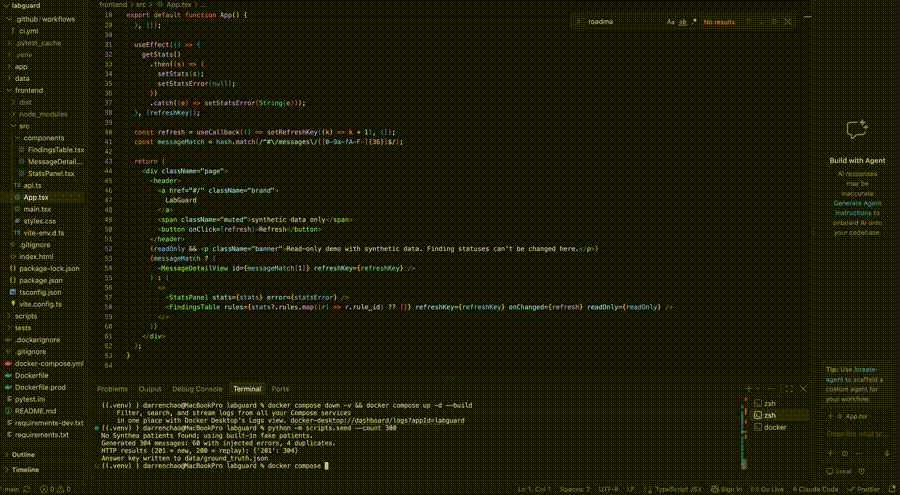
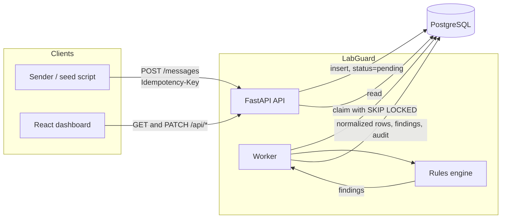
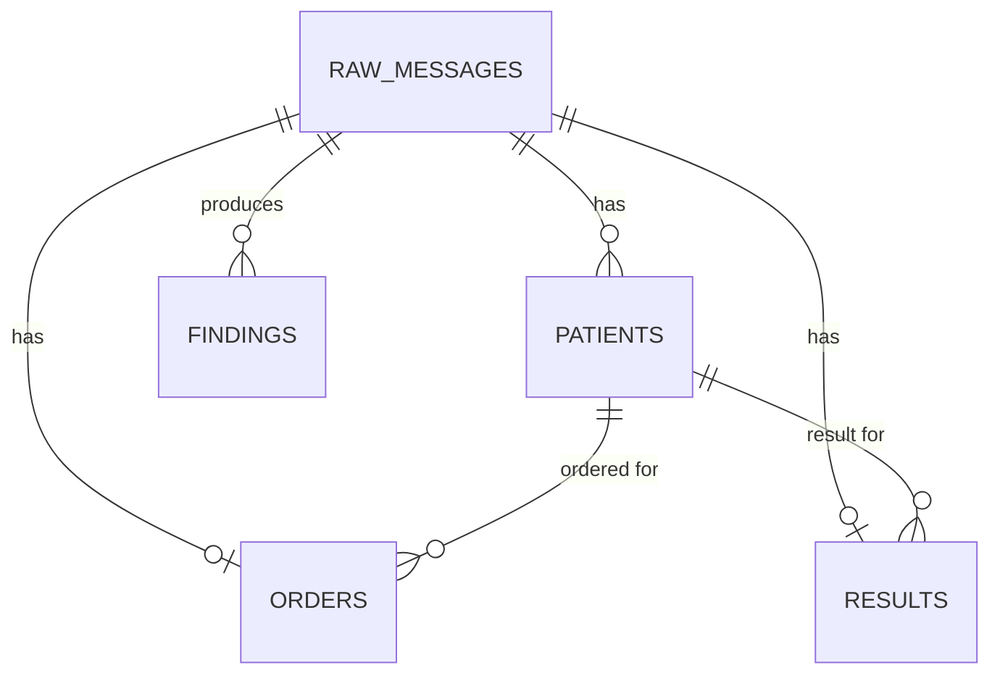

# LabGuard

[](https://github.com/tsundarren/labguard/actions/workflows/ci.yml)

Ingests synthetic lab messages (FHIR), validates them against a rules engine to catch
requisition-vs-result discrepancies, and keeps an audit trail of every finding.

**All data is synthetic. No real patient data is used.** The project is inspired by comparing
requisition forms against electronic records in a clinical lab. It is not production healthcare
software and makes no HIPAA-compliance claims.

**Status:** working end to end: idempotent ingestion, queue worker, rules engine, review dashboard,
accuracy report, and a hosted read-only demo. Planned items are in the [Roadmap](#roadmap).

## Live demo

**https://labguard-0b49.onrender.com/** (synthetic data, read-only)



Hosted on free tiers (Render and Neon): the first load after a period of inactivity can take about a minute
while the service wakes up.

## What it demonstrates

- **Idempotent ingestion:** unique-key upserts, so retries and concurrent duplicates can't double-insert.
- **A Postgres-backed worker queue** using `FOR UPDATE SKIP LOCKED`, with retry limits and an append-only audit log.
- **Labeled-error evaluation:** injected errors with precision and recall per rule (a regression check, not a
  real-world accuracy estimate).
- **A deployed review dashboard** with a requisition-vs-lab-record drill-down.

**Stack:** Python, FastAPI, PostgreSQL, React, TypeScript, Docker, GitHub Actions.

## Architecture




`audit_log` is append-only and references entities by type and id.

## Quickstart

```bash
python -m venv .venv && source .venv/bin/activate
pip install -r requirements-dev.txt

docker compose up -d --build      # Postgres + API (http://localhost:8000) + worker
python -m scripts.seed --count 500
docker compose logs -f worker     # watch findings being produced
pytest -v                         # needs Postgres from the first command; wipes all tables
```

Requires Python 3.10+ (3.12 recommended) and Docker. API docs: http://localhost:8000/docs

### Optional: realistic patients from Synthea
Synthea needs Java. Download `synthea-with-dependencies.jar` from the Synthea GitHub
releases and run `java -jar synthea-with-dependencies.jar -p 100`. Copy the FHIR bundles from
`output/fhir/` into `data/synthea/`. The seed script then uses those patients' demographics.
Synthea doesn't produce orders or specimens, so the seed script builds those itself.
Without Synthea it falls back to built-in fake patients.

## Project layout

```
app/
  main.py              FastAPI app: POST /messages, GET /messages/{id}, /health, /healthz;
                       serves the built dashboard in the production image
  dashboard_api.py     /api/* endpoints for the dashboard
  ingest.py            idempotent insert logic
  models.py            SQLAlchemy tables
  parsing.py           FHIR Bundle -> plain dataclasses (no database)
  reference.py         test catalog: expected specimen, plausible and reference ranges
  security.py          API-key and read-only guards for the public demo
  config.py            environment settings
  worker.py            queue worker
  rules/               rules framework, registry, engine, rule implementations
scripts/
  seed.py              synthetic data generator with labeled error injection
  accuracy.py          precision and recall against the answer key
  loadtest.py          ingest and processing throughput test
frontend/              React + TypeScript dashboard (Vite)
tests/                 unit tests (no DB) and integration tests (need Postgres)
Dockerfile             development image used by docker compose
Dockerfile.prod        production image: dashboard build + API
docker-compose.yml     Postgres + API + worker for local development
```

## Ingestion API

`POST /messages` accepts a FHIR `Bundle` containing the order (`ServiceRequest`), the patient as
written on the requisition and as recorded with the result (`Patient`), the `Specimen`, and the
result (`Observation`). Responses: `201` new message, `200` replay of an earlier request, `409` same
idempotency key reused with a different payload, `422` not a valid Bundle.

### Design decisions

**Idempotent ingestion.** Senders retry. `INSERT ... ON CONFLICT DO NOTHING` on a unique
`idempotency_key` lets the database decide the winner, so concurrent retries can't both insert.
Same key + same payload returns the original (200). Same key + different payload is a 409.
With no key supplied, the SHA-256 of the canonical payload is used as the key.

**Same content, new key is stored, not rejected.** The duplicate-submission rule should
*detect and report* that, not silently drop it. The seed script injects these on purpose.

**Raw payload stored as JSONB, untouched.** Every finding can trace back to the exact input,
and rules can be re-run when logic changes.

**Append-only audit log.** The app only INSERTs into `audit_log`.

**Minimal validation at the API boundary.** The API checks only "is this a non-empty FHIR
Bundle". Clinical validation belongs to the rules engine, so bad data gets recorded and flagged
rather than bounced.

**Labeled error injection.** Each injected error breaks exactly one thing (and avoids
accidentally triggering other rules) so detection accuracy can be measured cleanly.
Accuracy scoring covers the labeled rules; anything without ground truth is reported separately as unscored.

## Processing Engine

The worker claims pending messages, parses them into normalized tables, runs every registered rule,
stores findings, and writes audit entries.

```bash
docker compose up -d --scale worker=2   # run two workers on the same queue
python -m app.worker --drain            # or run one locally until the queue is empty
```

### Rules (ids match the seed generator's answer key)

| Rule id | Severity | Checks |
|---|---|---|
| `identity_mismatch` | error | MRN, DOB, family and given name on the requisition vs. the lab record (one finding per differing field) |
| `test_mismatch` | error | Ordered test code equals performed test code |
| `specimen_mismatch` | error | Specimen type is appropriate for the ordered test |
| `missing_field` | error | Collection time, specimen ID, ordering provider, result value |
| `timestamp_order` | error | Result issued at or after specimen collection |
| `implausible_value` | error | Value inside the physiologically possible range for the test |
| `duplicate_submission` | warning | Identical content already received under a different idempotency key (only the later copy is flagged) |

### Design decisions

**Claim + process in one transaction.** A worker locks a pending message, processes it, and
commits once. Crash or error means rollback and the message is simply `pending` again
(at-least-once processing). There is no committed "processing" state to get stuck in.

**`FOR UPDATE SKIP LOCKED`.** Locked rows are skipped, not waited on. Plain `FOR UPDATE` would make
workers queue behind the same row, and after the wait the row no longer matches
`status = 'pending'`, so a `LIMIT 1` query can return nothing while messages remain.

**Two kinds of failure.** An unparseable message (`ParseError`) can never succeed, so it is parked as
`failed` immediately. An unexpected error (DB hiccup, bug) is retried: the attempt is counted in a *new*
transaction (the old one rolled back) and the message is parked after `WORKER_MAX_ATTEMPTS`. A poison
message therefore cannot block the queue.

**Idempotent processing.** Normalized rows are wiped and rebuilt (delete cascades), and findings have
a unique `(message, rule, field)` constraint with `ON CONFLICT DO NOTHING`. Reprocessing a message,
which happens after a crash or when rules change, can't create duplicates.

**Rules are pure functions over a parsed message.** The parser and rules never touch the database, so
they are unit-tested without Postgres. Adding a rule = one class + `@register`; the engine never changes.

**A buggy rule is not a finding.** If a rule raises, the exception propagates and the message is
retried or parked, instead of silently skipping that rule.

**Findings describe the field, not the patient's values**, so identifiers aren't copied into a second table.

## Dashboard

A React + TypeScript (Vite) app for reviewing findings: summary cards, findings by rule, a filterable
findings queue with resolve / false-positive / reopen actions, and a per-message drill-down showing the
requisition vs. lab record side by side with the audit trail.

```bash
docker compose up -d --build        # API + worker + db
python -m scripts.seed --count 500  # something to look at
cd frontend && npm install && npm run dev
```
Open http://localhost:5173. In development, Vite proxies `/api` to the API on port 8000, so there is no CORS setup.

**API:** `GET /api/config`, `GET /api/stats`, `GET /api/findings` (filters: `status`, `rule_id`, `severity`,
`limit`, `offset`), `PATCH /api/findings/{id}`, `GET /api/messages/{id}`. In read-only mode (the hosted demo),
`PATCH` returns 403 and the dashboard hides the status buttons. There is no user authentication. This is a demo of
synthetic data and would need auth, per-user audit actors, and access controls before anything real.

**Design decisions.** Status changes never delete anything: every transition writes an audit entry with the old
and new state. The dashboard shows field names and descriptions; identifiers appear only on the drill-down page.

## Accuracy report

```bash
python -m scripts.seed --count 500
# wait for the worker to finish, then:
python -m scripts.accuracy              # or --markdown to paste a table here
```

Scores each rule against the seed script's answer key: injected, detected, missed, false positives, precision, recall.

**How to read it.** The injected errors were designed alongside the rules, so near-perfect scores are expected.
This confirms detection works end to end and catches regressions. It is **not** an estimate of accuracy on real data.
Making it more informative means adding harder cases (name typos and nicknames, borderline values, formatting noise)
and measuring what breaks.

| Rule | Injected | Detected | Missed | False pos. | Precision | Recall |
|---|---|---|---|---|---|---|
| identity_mismatch | 16 | 16 | 0 | 0 | 100.0% | 100.0% |
| test_mismatch | 13 | 13 | 0 | 0 | 100.0% | 100.0% |
| specimen_mismatch | 17 | 17 | 0 | 0 | 100.0% | 100.0% |
| missing_field | 14 | 14 | 0 | 0 | 100.0% | 100.0% |
| timestamp_order | 16 | 16 | 0 | 0 | 100.0% | 100.0% |
| implausible_value | 20 | 20 | 0 | 0 | 100.0% | 100.0% |
| duplicate_submission | 10 | 10 | 0 | 0 | 100.0% | 100.0% |
| ALL (micro) | 106 | 106 | 0 | 0 | 100.0% | 100.0% |

510 messages scored

## Load test

```bash
python -m scripts.loadtest --count 2000 --concurrency 20 --label "1 worker" --markdown
```

Measured on an Apple M1 Pro (16 GB RAM, Docker limited to 10 CPUs and 8 GB), with Postgres and the API in
Docker Compose, 2,000 messages.

**Load test: 1 worker**

| Metric | Result |
|---|---|
| Messages sent | 2000 |
| Accepted (201/200) | 2000 |
| Errors / other | 0 |
| Concurrency | 20 |
| Ingest throughput | 240 req/s |
| Latency p50 / p95 / p99 | 80 ms / 122 ms / 142 ms |
| Time until all processed | 10.7 s |
| End-to-end throughput | 188 msg/s |

**Load test: 2 workers**

| Metric | Result |
|---|---|
| Messages sent | 2000 |
| Accepted (201/200) | 2000 |
| Errors / other | 0 |
| Concurrency | 20 |
| Ingest throughput | 232 req/s |
| Latency p50 / p95 / p99 | 82 ms / 130 ms / 168 ms |
| Time until all processed | 9.4 s |
| End-to-end throughput | 213 msg/s |

**What the numbers show.** Ingestion tops out around 240 req/s, and a single worker nearly keeps pace: everything
was processed about 2.4 s after the last message was accepted. A second worker cut that tail to about 0.8 s, but
end-to-end throughput rose only from 188 to 213 msg/s because the test is ingest-bound. Likely limits are the single
API process and the database connection pool; I have not isolated which.

These numbers come from a laptop with everything on one machine, so they show relative behavior (for example, the
effect of adding a second worker), not production capacity.

## Deployment

**Hosted on:** Render (a free web service running the API, the built dashboard, and the embedded worker from
`Dockerfile.prod`) with Neon (serverless Postgres on the free plan).

| Variable | Purpose |
|---|---|
| `DATABASE_URL` | Postgres connection string (`postgres://` and `postgresql://` are accepted) |
| `API_KEY` | If set, `POST /messages` requires an `X-API-Key` header |
| `READ_ONLY` | `1` disables finding status changes, so visitors can't alter the demo data |
| `RUN_EMBEDDED_WORKER` | `1` (set in the image) runs the worker as a thread inside the API |
| `EMBEDDED_WORKER_POLL_INTERVAL` | Fallback poll in seconds for the embedded worker (default 900) |

**Why the worker is embedded here.** Free hosts don't offer free background workers. In the hosted demo, the API wakes
the worker whenever a message is accepted, with a long fallback poll. Locally, `docker compose` runs the worker as its
own service, which is the better design for real use because workers can then scale independently.

**Scale-to-zero friendly.** The hosted database suspends when idle, so nothing polls it constantly: the worker is
woken by new messages, the platform health check (`/healthz`) never touches the database, and the dashboard doesn't poll.

## Verifying it works

**Idempotency.** Run `python -m scripts.seed --count 500` twice. The first run reports `201` for every
message, the second reports `200` for every message, and no new rows are added.

**Detection vs. the answer key.** With a freshly seeded database and the worker finished, the findings
per rule should match the injected errors exactly:

```bash
docker compose exec db psql -U labguard -c "SELECT rule_id, count(*) FROM findings GROUP BY 1 ORDER BY 1;"

python -c "import json,collections;d=json.load(open('data/ground_truth.json'));print(collections.Counter(e for i in d['items'] for e in i['errors']))"
```

**Concurrency.** The test suite includes a concurrent-insert test for ingestion and a two-worker test
asserting every message is processed exactly once.

## Roadmap

- [x] Duplicate-submission rule (same content, different idempotency key)
- [x] Accuracy report: precision and recall against `data/ground_truth.json`
- [x] React dashboard: findings queue, error rates by rule, message drill-down
- [x] Deployment, architecture diagram, demo GIF, load test
- [ ] Rule: abnormal-but-plausible results (warning severity)
- [ ] Harder test data for the accuracy report (typos, nicknames, borderline values)
- [ ] Stretch: HL7 v2 input
- [ ] Stretch: Alembic migrations
- [ ] Stretch: retry backoff

## Known limits

- The schema is created with `create_all`; add Alembic before changing existing tables.
- Failed retries have no backoff delay.
- If rule logic changes, stale findings from the old logic are not auto-resolved.
- Reference ranges are a small illustrative catalog, not a clinical lab catalog.
- The hosted demo runs on free tiers, so it sleeps when idle and the first request can be slow.

## Security notes

- All data is synthetic and the hosted demo is read-only.
- Writers can be required to present an API key; the key is compared in constant time.
- There is no user authentication or authorization. Real use would need that, TLS everywhere, encryption at rest,
  per-user audit identities, retention policies, and a compliance review. HIPAA compliance is not claimed.
